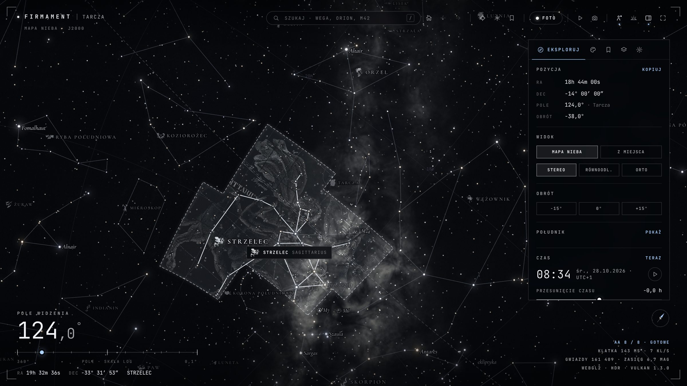
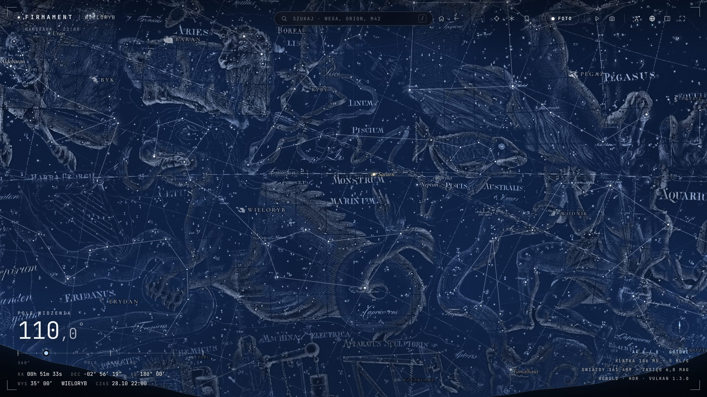
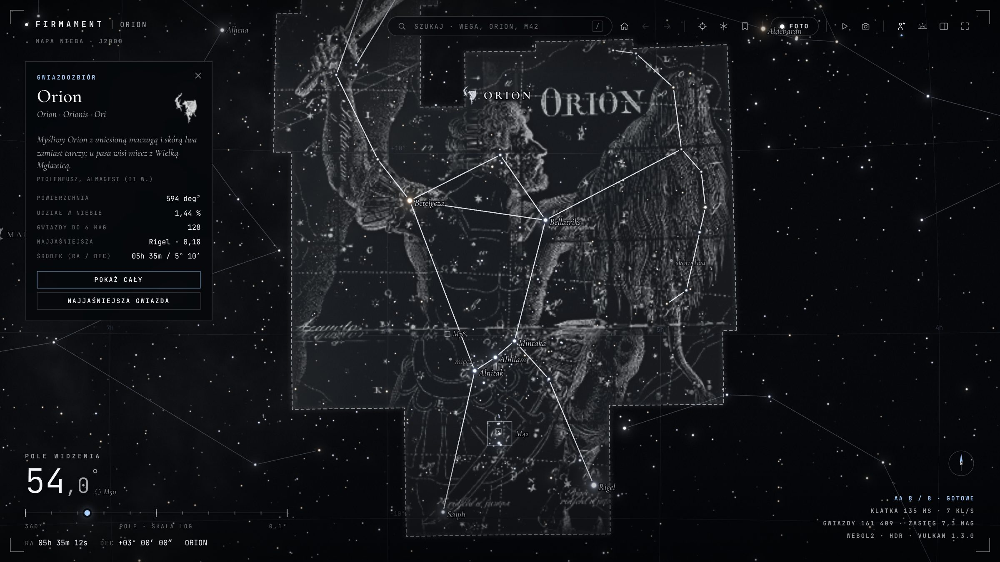
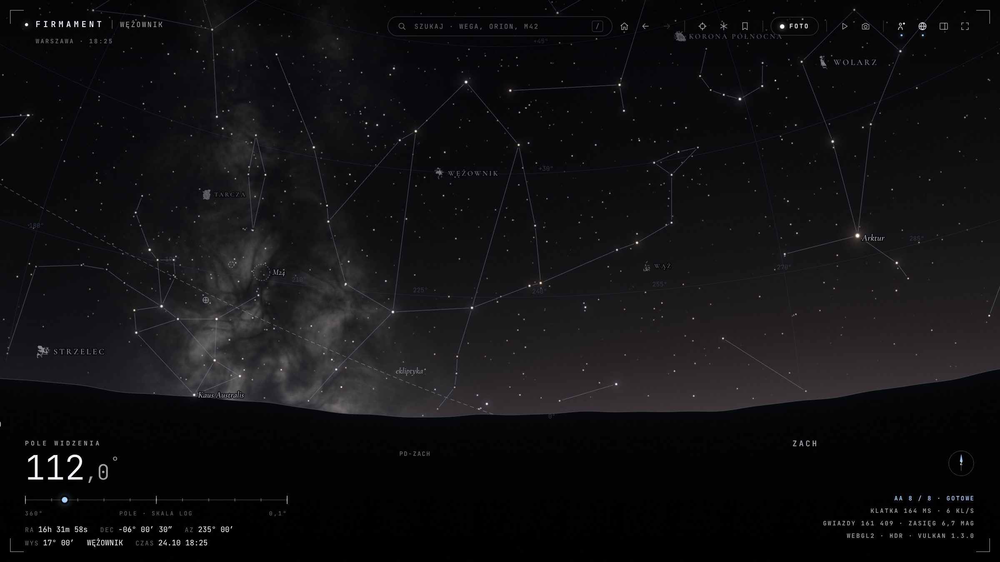

# Firmament

Interaktywna mapa nieba w przeglądarce: prawdziwe gwiazdy, 88 gwiazdozbiorów z ilustracjami i opisami oraz widok nieba nad dowolnym miejscem o dowolnej porze. Całość to jeden plik HTML, bez instalacji i bez serwera.

[English](README.md) · interfejs programu jest po polsku



<p align="center"><sub>Zaraz po otwarciu: centrum Drogi Mlecznej, nazwy wszystkich gwiazdozbiorów z ikonami i ilustracja gwiazdozbioru wskazanego kursorem.</sub></p>

| Wygląd „Mitologia”, Warszawa o 22:00 | Karta gwiazdozbioru i podpisy atrybutów | Widok z miejsca o zmierzchu |
|---|---|---|
|  |  |  |

## Co potrafi

- **Ok. 41 tys. prawdziwych gwiazd do 8 mag** z bazy HYG (Hipparcos), w barwach odpowiadających temperaturze, przesuniętych o ruch własny na pokazywaną datę. Po przybliżeniu dochodzi dekoracyjne tło słabszych gwiazd. Znane gwiazdy, takie jak Syriusz, Gwiazda Polarna, Wega czy Algol, mają podpis zawsze; nazwy pochodzą z oficjalnej listy IAU, a najbardziej znane mają polską formę.
- **Karta gwiazdy** podaje odległość w latach świetlnych i parsekach (z paralaksy Hipparcosa, z zaznaczeniem, gdy pomiar jest niepewny), rzeczywistą jasność w porównaniu ze Słońcem, typ widmowy i temperaturę.
- **Gwiazdy podwójne:** bliskie pary, np. Albireo, Mizar i Alkor czy ε Lutni, mają opis i przycisk „Pokaż parę”. Przybliżenie sięga 0,1°, gdzie składniki się rozdzielają i widać ich barwy (Albireo: złota i niebieska).
- **Wszystkie 88 gwiazdozbiorów:** linie figur, granice IAU i nazwy w trzech wielkościach (najmniej znane najmniejsze), każda z małą ikoną figury.
  - Półprzezroczyste **ilustracje** z atlasu Johanna Elerta Bodego *Uranographia* (1801), oczyszczone z siatki i symboli gwiazd i dokładnie nałożone na niebo. Wskazany kursorem gwiazdozbiór podświetla się, a na rysunku pojawiają się podpisy atrybutów, np. maczuga, głowa Meduzy czy kłos zboża.
  - Karta każdego gwiazdozbioru mówi, co przedstawia figura i kto ją wprowadził: Ptolemeusz, Heweliusz, Lacaille…
- **Obiekty Messiera, planety, Księżyc z fazą, Słońce, Droga Mleczna.** Cefeidy mają w karcie okres pulsacji i zakres jasności.
- **Widok z miejsca:** niebo nad wybranym miastem albo współrzędnymi o wybranej porze, z precesją, refrakcją, horyzontem, zmierzchem i strefą czasową miejsca. Upływ czasu można przyspieszać.
- **14 wyglądów** (Realistyczny, Mitologia, Porcelana, Atlas…), edytor palety oraz eksport i import własnych stylów.
- **Wycieczka po niebie** (19 przystanków z podpisami) i 40 celów w zakładce „Na co warto spojrzeć”.
- **Południki:** dowolne koło godzinne (wskazane na niebie albo suwakiem) lub południk miejscowy nad miejscem obserwacji. Panel wypisuje gwiazdozbiory, które przecina, od północy na południe, a widok może przejechać wzdłuż niego, podpisując kolejne (`L`).
- **Tryb fotograficzny:** kadry 16:9, 3:2, 1:1 i 4:5, eksport do 6K.
- **Jakość obrazu:** bufory HDR, progresywne wygładzanie po zatrzymaniu i płynność w ruchu.

## Uruchomienie

Pobierz **`Firmament.html`** i otwórz go dwuklikiem. Działa w aktualnym Chrome, Edge, Firefoksie i Safari, potrzebuje WebGL. Internet przydaje się tylko do czcionek z Google Fonts; bez niego program działa na czcionkach zastępczych.

Program można też udostępnić przez **GitHub Pages**: *Settings → Pages → Deploy from a branch → `main`, `/ (root)`*. Po chwili będzie dostępny pod adresem `https://<użytkownik>.github.io/<repozytorium>/`; plik `index.html` w głównym folderze przekierowuje na `Firmament.html`. Po każdej zmianie w `src/` uruchom `python build.py` przed commitem, żeby opublikowany plik był aktualny.

## Obsługa

- **Przeciągnij**, aby przesuwać niebo. **Kółko myszy** przybliża w stronę kursora, a **dwuklik** przelatuje do wskazanego miejsca.
- **Najedź kursorem** na gwiazdozbiór, żeby go podświetlić. **Kliknij**, żeby otworzyć kartę gwiazdozbioru, gwiazdy, planety albo obiektu.
- Wyszukiwarka zna nazwy polskie, łacińskie i angielskie (np. „Syriusz”, „Sirius”, „Gwiazda Północna”) oraz numery M.

| Klawisz | Działanie | Klawisz | Działanie |
|---|---|---|---|
| `H` | widok startowy | `T` | wycieczka |
| `M` | mapa / widok z miejsca | `I` | ilustracje gwiazdozbiorów wł./wył. |
| `N` | niebo dziś o 22:00 | `P` | tryb fotograficzny (`Enter` – zdjęcie) |
| `R` | losowy cel | `spacja` | upływ czasu |
| `Q` / `E` | obrót | `+` / `−` | zoom |
| `L` | przejazd wzdłuż południka | `/` | wyszukiwarka |
| `Esc` | odznacz, wyjdź | | |

Ustawienia, własne style i zapisane widoki są pamiętane w przeglądarce (localStorage).

## Rozwój

Źródła leżą w `src/`. Otwórz `src/index.html` w przeglądarce, edytuj pliki i odświeżaj stronę (F5); **budowanie nie jest potrzebne**. Gdy zmiany są gotowe, złóż jeden plik:

```
python build.py                         # -> Firmament.html
python build.py --out inny/plik.html    # zapis pod inną ścieżką
```

Wystarczy Python 3, bez dodatkowych bibliotek.

| Plik | Zawartość |
|---|---|
| `src/index.html`, `src/styles.css` | Układ i wygląd interfejsu (kolory w `:root`) |
| `src/js/00-util.js` | Matematyka wektorowa, formatowanie, pamięć przeglądarki |
| `src/js/01-data.js` | Rozpakowanie katalogu gwiazd i gwiazdozbiorów |
| `src/js/02-looks.js` | Wyglądy (`LOOKS`), domyślny styl, warstwy i ustawienia |
| `src/js/03-astro.js` | Czas gwiazdowy, precesja, refrakcja, Słońce, Księżyc, planety, strefy czasowe, cefeidy |
| `src/js/04-view.js` | Stan widoku, miejsca obserwacji (`LOCS`), rzutowania, widok startowy (`HOME`) |
| `src/js/05-gl.js` | Renderer WebGL: niebo, Droga Mleczna, gwiazdy, ilustracje |
| `src/js/06-overlay.js` | Nakładka 2D: linie, nazwy z ikonami, podpisy, obiekty, planety |
| `src/js/07-main.js` | Pętla renderu, animacje, wybieranie obiektów, karta, wycieczka, tryb foto |
| `src/js/08-ui.js` | Panel, suwaki, wyszukiwarka, statystyki |
| `src/js/10-meridian.js` | Południki: rysowanie, przecinane gwiazdozbiory, przejazd |
| `src/js/99-boot.js` | Start programu |
| `src/data/content.js` | **Treści pisane ręcznie:** opisy 88 figur, podpisy atrybutów, znane gwiazdy, cele wycieczki |
| `src/data/skydata.js`, `src/data/artdata.js` | Dane wygenerowane przez narzędzia (nie edytuj ręcznie) |
| `tools/fetch_sources.py` | Pobranie katalogów HYG, IAU i OpenNGC i zapisanie potrzebnych wycinków w `tools/raw/` |
| `tools/prep_data.py`, `tools/prep_art.py` | Generatory danych z plików w `tools/raw/` |
| `tools/bode/` | Zamiana skanów atlasu Bodego w ilustracje rozpięte na niebie (`tools/raw/bode/`); opis w [`tools/bode/README.md`](tools/bode/README.md) |
| `build.py` | Składanie `Firmament.html` |
| `index.html`, `.nojekyll` | Przekierowanie na `Firmament.html` dla GitHub Pages; `.nojekyll` wyłącza przetwarzanie strony przez Jekyll |

### Odświeżenie danych

Potrzebne tylko po zmianie `tools/*.py` albo plików w `tools/raw/`:

```
pip install -r tools/requirements.txt
python tools/fetch_sources.py  # opcjonalnie: świeże kopie katalogów gwiazd, nazw i obiektów Messiera (ok. 40 MB)
python tools/prep_data.py      # gwiazdy, gwiazdozbiory, Droga Mleczna (kilka minut)
python tools/prep_art.py       # ilustracje i ikony (kilkadziesiąt sekund)
python build.py
```

Same ilustracje powstają ze skanów atlasu Bodego za pomocą skryptów z `tools/bode/` (opis w tamtejszym README); ich wynik jest już w `tools/raw/bode/`.

Pomocnicze API do testów jest dostępne z konsoli przeglądarki jako `window.__firmament`.

## Dokładność

Obliczenia sprawdzono z biblioteką astropy (ERFA), katalogiem SIMBAD i niezależną kopią danych:

- **pozycje gwiazd:** Hipparcos (nowa redukcja, J2000) przesunięty o ruch własny na pokazywaną datę; HYG i wcześniejsze dane z d3-celestial zgadzają się z medianą 0,14″;
- **gwiazdy w widoku z miejsca:** poniżej 0,01° (precesja z J2000 do daty obserwacji, refrakcja);
- **Słońce i planety:** poniżej 1′ w latach 1900–2100;
- **Księżyc:** ok. 1′, z paralaksą topocentryczną;
- **obiekty Messiera:** środki, rozmiary i ułożenie z OpenNGC (poprzednie dane myliły się przy niektórych obiektach nawet o 19′);
- **przynależność gwiazd do gwiazdozbiorów:** dokładnie według granic IAU w układzie B1875, w którym każda krawędź biegnie wzdłuż stałej rektascensji albo deklinacji. Granice są przeliczane w tym układzie, co usunęło też błąd danych źródłowych przy biegunie północnym (granica Małej Niedźwiedzicy i Cefeusza była przesunięta nawet o 0,45° na południe). Powierzchnie gwiazdozbiorów zgadzają się z wartościami IAU.

Nazwy gwiazd pochodzą z oficjalnej listy IAU WGSN, co poprawiło kilka nazw odziedziczonych po starszych danych (np. cefeida η Aquilae była kiedyś podpisana „Tarazed”, nazwą γ Aql). Gwiazdy tła słabsze niż 8 mag są generowane dekoracyjnie (rozkład podąża za Drogą Mleczną) i nie odpowiadają prawdziwym gwiazdom.

## Licencja

- **Kod programu** (`src/js/`, `src/index.html`, `src/styles.css`, `src/data/content.js`, `build.py`, `tools/*.py`): licencja **MIT**, zob. [`LICENSE`](LICENSE).
- **Dane i grafiki** mają licencje swoich autorów:
  - ilustracje gwiazdozbiorów (`src/data/artdata.js`, `tools/raw/bode/`) – ryciny J. E. Bodego (1801), **domena publiczna**; ich obróbka jest częścią kodu na licencji MIT;
  - dane katalogowe (`src/data/skydata.js`, `tools/raw/`) – **CC BY-SA 4.0** (HYG, OpenNGC), **BSD-3-Clause** (d3-celestial) i **MIT** (lista nazw IAU w zestawieniu C. Schneck).

  Szczegóły i pełne teksty licencji: [`THIRD_PARTY_NOTICES.md`](THIRD_PARTY_NOTICES.md).

## Podziękowania i inspiracje

**Dane i grafiki**
- Johann Elert Bode, *Uranographia sive astrorum descriptio* (Berlin 1801): ilustracje i ikony gwiazdozbiorów. Skany: ETH-Bibliothek Zürich, [e-rara.ch](https://www.e-rara.ch/zut/content/titleinfo/3341734).
- [Baza HYG](https://github.com/astronexus/HYG-Database) 4.1 (David Nash): gwiazdy z ruchem własnym, odległościami, typami widmowymi i oznaczeniami Bayera i Flamsteeda.
- [Grupa robocza IAU ds. nazw gwiazd](https://www.iau.org/public/themes/naming_stars/): oficjalne nazwy gwiazd, w zestawieniu [Cory Schneck](https://github.com/cyschneck/iau-star-names).
- [OpenNGC](https://github.com/mattiaverga/OpenNGC) (Mattia Verga): pozycje, rozmiary i ułożenie obiektów Messiera.
- [d3-celestial](https://github.com/ofrohn/d3-celestial) (Olaf Frohn): linie, granice i etykiety gwiazdozbiorów, lista obiektów Messiera, kontury Drogi Mlecznej.
- Katalog Hipparcos: ESA (1997), *The Hipparcos and Tycho Catalogues*, ESA SP-1200; F. van Leeuwen (2007), A&A 474, 653.

**Cudzy kod w programie**
- [webgl-noise](https://github.com/ashima/webgl-noise) (Ian McEwan, Stefan Gustavson, Ashima Arts, MIT): szum simpleksowy 3D w shaderach nieba i Drogi Mlecznej.
- mulberry32 (Tommy Ettinger, domena publiczna): generator liczb pseudolosowych dla gwiazd tła.

**Algorytmy i źródła naukowe**
- J. Meeus, *Astronomical Algorithms* (2. wyd., 1998): czas gwiazdowy, teoria Księżyca (główne wyrazy), paralaksa.
- J. H. Lieske i in. (1977), A&A 58, 1: precesja IAU 1976.
- G. G. Bennett (1982), *Journal of Navigation* 35, 255 oraz Þ. Sæmundsson (1986), *Sky & Telescope* 72, 70: refrakcja atmosferyczna.
- E. M. Standish, JPL: *Keplerian Elements for Approximate Positions of the Major Planets*. Poprawki dla planet zewnętrznych dopasowano do efemeryd ERFA (astropy).
- E. Delporte (1930): granice gwiazdozbiorów. N. G. Roman (1987), PASP 99, 695: wyznaczanie gwiazdozbioru po przeniesieniu pozycji do epoki B1875.
- F. J. Ballesteros (2012), EPL 97, 34008: temperatura gwiazdy z barwy B−V.
- J. H. Halton (1960): ciąg o niskiej rozbieżności, użyty do przesunięć próbek przy wygładzaniu.

**Inspiracje**
- Plakat *88 Constellations and Their Brightest Stars* ([Dark Sky New Mexico](https://darkskynewmexico.com/2019-6-3-88-constellations-and-their-brightest-stars/)): pomysł na wygląd „Mitologia”.
- DeepZoom: paleta barw i minimalistyczny interfejs.
- Stellarium: ogólny wzór interaktywnego planetarium; z niego pochodzi też sposób rozpinania rysunku na sferze według trzech punktów.

**Weryfikacja:** [astropy](https://www.astropy.org) / ERFA i baza [SIMBAD](https://simbad.u-strasbg.fr) (CDS, Strasburg). **Czcionki:** JetBrains Mono, Cormorant Garamond, Barlow Semi Condensed (Google Fonts, SIL OFL).

Program powstał przy pomocy asystenta AI Claude (Anthropic).
